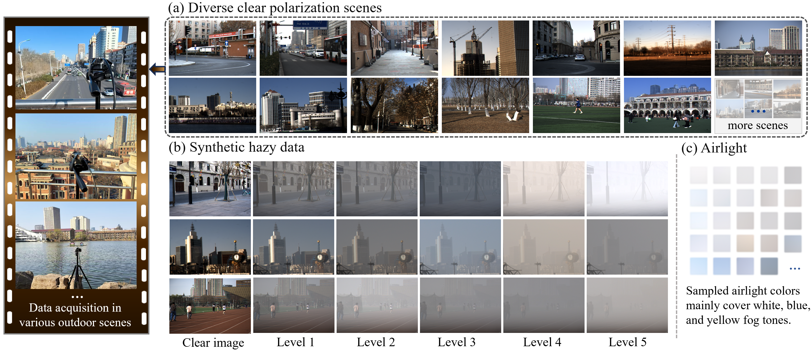

<h2 align="center">
Polarization Image Dehazing: Data Synthesis and Bidirectional Intensity–Polarization Restoration
</h2>

<b><p align=center>

</p></b>

## 📌 Overview

> ⚙️ This repository is being processed. Code, pretrained weights, and the PolHaze dataset will be released upon acceptance.

**Data:** Existing polarization dehazing datasets either rely on simplified synthesis assumptions or on small-scale controlled capture, which limits their realism and diversity and, in turn, the development of polarization-based dehazing methods. We construct **PolHaze**, a paired polarization haze dataset with 20,630 samples from 2,063 clear outdoor scenes.

**Method:** Existing methods still struggle to recover polarization information. Polarization itself is useful, since it carries physical cues beyond intensity and can support both haze removal and downstream vision tasks. We further explore how to restore polarization more faithfully, and how to use it more efficiently to guide image dehazing. **BIPRNet** is proposed for this purpose.

## 🔥 News

- **2026-10-12:** Repository initialized. Code and data will be released upon acceptance.

## 1. PolHaze

PolHaze pairs captured clear polarization scenes with depth-dependent transmission and real polarized airlight, covering diverse outdoor scenes and haze densities.

<p align="center">
  
</p>

## 2. BIPRNet

BIPRNet lets the two restoration tasks reinforce each other. Recovered intensity guides polarization restoration, and the restored polarization in turn guides dehazing.

PolHaze test set:

<p align="center">
  
</p>

Real haze:

<p align="center">
  
</p>

## 🚀 Code

To be released upon acceptance, in the same two parts.

### PolHaze

- Dataset download
- Sample format: four polarization angles, intensity, DoP, and AoP
- Synthesis pipeline

### BIPRNet

- Environment
- Pretrained weights
- Training and inference

```text
polhaze/     # dataset and synthesis
biprnet/     # network, training, and inference
```

## 📎 Citation

## 💡 Acknowledgments

We thank the authors of [DehazeFormer](https://github.com/IDKiro/DehazeFormer) and [Polarization-Aware Low-Light Image Enhancement](https://github.com/fourson/Polarization-Aware-Low-Light-Image-Enhancement) for their excellent work.

## ✉️ Contact

If you have any questions about this work, please feel free to contact us at [feixiaotong@tju.edu.cn](mailto:feixiaotong@tju.edu.cn).
